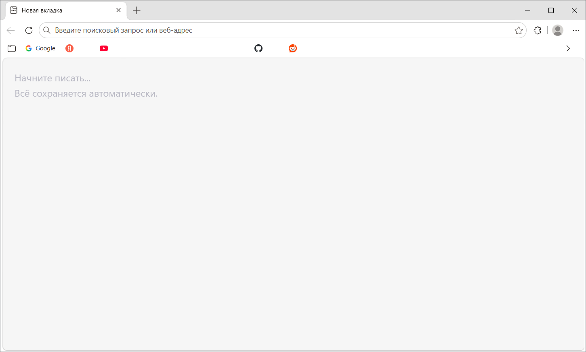
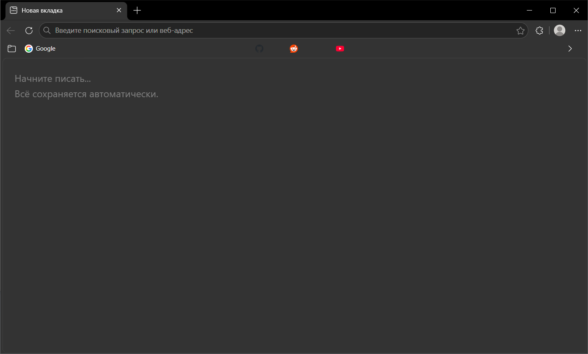

# Minimal New Tab

Минималистичная страница новой вкладки для Microsoft Edge и Chrome. Расширение убирает визуальный шум стандартной вкладки, оставляя чистый фон и встроенный блокнот. Текст заметок автоматически сохраняется и восстанавливается при открытии новой вкладки. Цвет фона адаптируется к светлой или тёмной теме ОС.

## Возможности

- **Чистый фон** — никаких новостей, виджетов или обоев.
- **Встроенный блокнот** — пишите заметки прямо на новой вкладке.
- **Автосохранение** — текст сохраняется автоматически во время ввода.
- **Резервное копирование** — данные дублируются в `localStorage`, предотвращая потерю заметок при сбое или закрытии вкладки.
- **Синхронизация между вкладками** — открытые вкладки подхватывают изменения друг друга через `chrome.storage.onChanged`.
- **Ручное сохранение** — `Ctrl+S` / `Cmd+S`.
- **Адаптация к теме** — автоматическое переключение фона.
- **Доступность** — `prefers-reduced-motion`, `forced-colors`, видимое кольцо фокуса, `label` и отдельный `aria-live`-регион для статусов.
- **Проверка орфографии** — включена по умолчанию.
- **Конфиденциальность** — расширение не собирает данные.

## Скриншоты

| Светлая тема | Тёмная тема |
|--------------|-------------|
|  |  |

## Установка

### Microsoft Edge Add-ons

*Ссылка будет добавлена после публикации.*

### Режим разработчика

1. Скачайте и распакуйте архив.
2. Откройте `edge://extensions/`.
3. Включите **режим разработчика**.
4. Нажмите **Загрузить распакованное** и выберите папку.
5. Откройте карточку расширения и убедитесь, что:
   - расширение **включено** (Edge может отключить его сразу после установки);
   - включён переключатель **«Разрешить доступ к файловым URL-адресам»**;
   - в блоке новой вкладки выбрано **«Minimal New Tab»** (или нажата кнопка «Set as new tab page»).
6. Нажмите `Ctrl+T` — должна открыться страница блокнота.

## Требования

- Microsoft Edge 116+ или Chrome 120+.
- Разрешения `storage` и `unlimitedStorage`.

## Известные ограничения

- При одновременной активной печати в двух вкладках последняя сохранённая версия выигрывает. Idle-вкладка синхронизируется автоматически, а при конфликте показывается предупреждение.
- `pagehide` не гарантирует завершение асинхронной записи в `chrome.storage`. Именно поэтому основная защита — дебаунс-сохранение при вводе, `visibilitychange` и резервная копия в `localStorage`.
- Для текстов, превышающих лимит `localStorage` (~5 МБ), резервная копия может не создаться. В этом случае защита полагается на `chrome.storage.local` (который теперь безлимитен) и дебаунс-сохранение при вводе.
- В Microsoft Edge расширение новой вкладки может быть автоматически отключено после установки. Это политика браузера, а не ошибка расширения.

## Журнал изменений

### 2.1.0

- Добавлено разрешение `"unlimitedStorage"`, снято ограничение в 10 МБ.
- Удален тяжелый подсчет размера текста (`TextEncoder`), что ускорило работу при вводе.
- Удалена сложная логика обработки ошибок квоты (за ненадобностью).
- Для доступности добавлен тег `<label>` к текстовому полю, убран избыточный `aria-label`.

### 2.0.4

- Защита от гонки в `chrome.storage.onChanged`: собственное сохранение не вызывает ложного «конфликта» даже при вводе вперёд.
- `chrome.storage.local.QUOTA_BYTES` проверяется по типу, fallback — 10 МБ.
- `byteSize` использует `TextEncoder` вместо создания `Blob`.
- Сообщение о превышении размера содержит подсказку «Сократите заметку».
- `pagehide` вместо `beforeunload`; добавлен `visibilitychange` для сохранения при уходе с вкладки.
- Иконки 16 / 32 / 48 / 128.
- Favicon уменьшен до `icon-32.png`.

### 2.0.3

- Синхронизация между открытыми вкладками через `chrome.storage.onChanged`.
- Лимит размера берётся из `chrome.storage.local.QUOTA_BYTES`.
- Различаются ошибки квоты и прочие ошибки сохранения.
- Screen-reader-статус вынесен в отдельный `aria-live`-регион.
- `chrome.storage` используется через Promise API.
- Добавлен favicon и осмысленный `title` вкладки.

### 2.0.2

- Резервная копия не удаляется до успешной записи в `chrome.storage`.
- `Ctrl+S` работает на любой раскладке.
- Фокус ставится после загрузки заметок.
- При ошибке сохранения отложенная правка перезапускается с задержкой.
- Резервная копия дебаунсится при вводе.
- Проверка типа `result[STORAGE_KEY]`.
- `chrome.storage.local.set` обёрнут в `try/catch`.
- `body` использует `100dvh`.
- У `textarea` добавлен `aria-label`, у статуса — `role` и `aria-live`.

### 2.0.1

- Исправлена потеря правок, введённых во время сохранения (флаг `pendingSave`).
- Резервная копия перенесена из `sessionStorage` в `localStorage`.
- Исправлено восстановление полностью очищенного текста.
- `showStatus` корректно сбрасывает предыдущий таймер.

### 2.0.0

- Первый публичный релиз.

## Лицензия

MIT